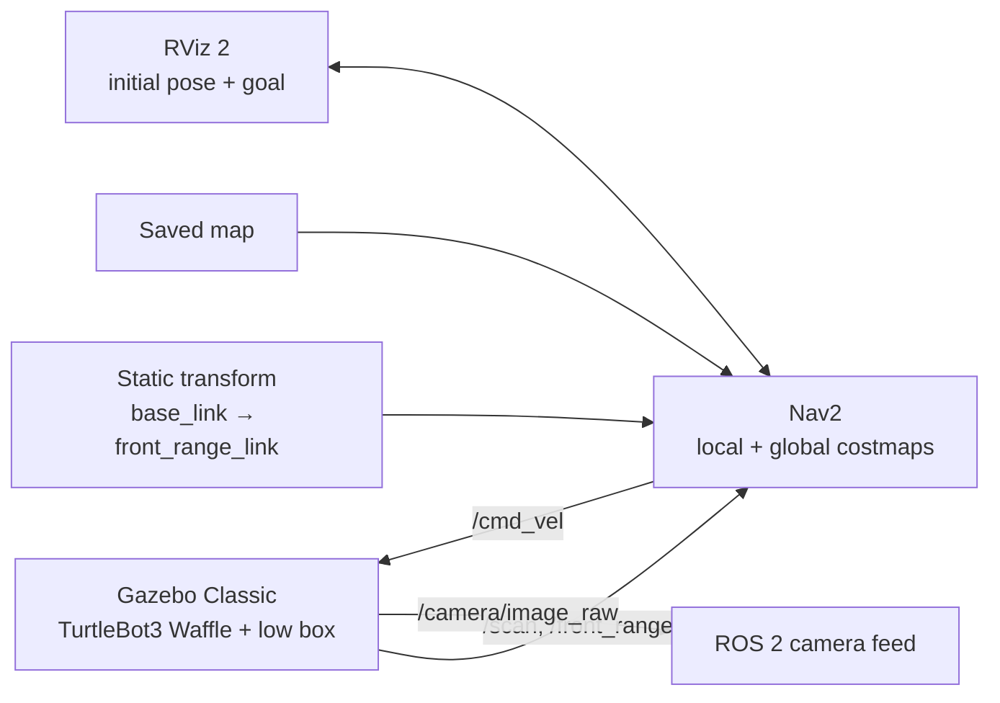

# TurtleBot3 Nav2 Camera and Range Sensor Integration


[](https://github.com/shreyas02005-sudo/nav2-camera-range-sensor/actions/workflows/ci.yml)

I added a camera and a low-mounted range sensor to a TurtleBot3 Waffle in Gazebo Classic, then connected the range sensor to Nav2's costmaps. The project explores how a sensor below the LiDAR scan plane can help a robot detect and navigate around a low obstacle.

**[Watch the two test runs](https://drive.google.com/drive/folders/1_qsFUcDb3oPudGYDkgD9RKODOBYeF5Z4?usp=sharing)**

The camera feed below was received over ROS 2 at 640x480.


---

## Contents

- [What it does](#what-it-does)
- [How it fits together](#how-it-fits-together)
- [Tested environment](#tested-environment)
- [Setup and run](#setup-and-run)
- [The obstacle demonstration](#the-obstacle-demonstration)
- [Repository layout](#repository-layout)
- [Troubleshooting](#troubleshooting)
- [What this project shows](#what-this-project-shows)
- [Limitations and next steps](#limitations-and-next-steps)
- [Acknowledgements](#acknowledgements)
- [License](#license)

---

## What it does

- Adds a **front-mounted, low range sensor** to a TurtleBot3 Waffle in Gazebo Classic.
- Feeds the range data into **both Nav2 costmaps**, so the local controller and global planner can account for low obstacles.
- Resizes the robot camera and publishes images on `/camera/image_raw` and camera calibration data on `/camera/camera_info`.
- Demonstrates the difference between stock LiDAR-only parameters and Nav2 configured with the range sensor layer.

| Configuration | Obstacle in costmap | Recorded outcome |
|---|---|---|
| Stock Nav2 parameters (LiDAR only) | No | The robot did not detect the box and collided with it. |
| Nav2 with the range sensor layer | Yes (local and global costmaps) | The planner routed around the box. |

This is a qualitative demonstration from one obstacle layout, not a controlled benchmark. The available results do not establish that the start pose, goal, and box position were identical between runs.

## How it fits together



The range sensor is mounted 4 cm above the base link origin. Its five-ray scan has a 0.4 rad field of view and 1.5 m maximum range. The static transform is launched separately because the range link is present in the Gazebo model but not the URDF used by `robot_state_publisher`.

## Tested environment

- Ubuntu 22.04 under WSL2, ROS 2 Humble, Gazebo Classic 11 with `gazebo_ros_pkgs`
- TurtleBot3 Waffle packages built from source in `~/turtlebot3_ws` so the model can be edited
- Nav2 (`navigation2`, `nav2_bringup`) and `turtlebot3_navigation2`
- CycloneDDS (`ros-humble-rmw-cyclonedds-cpp`)
- A saved map and a Gazebo world for navigation

This project builds on a separate SLAM and navigation setup using a custom Gazebo world and a Cartographer map. You will need a working Nav2 setup of your own; see the [setup guide](docs/setup.md).

## Setup and run

The [setup and reproduction guide](docs/setup.md) includes the prerequisites, checks, and full procedure. The short version is to use CycloneDDS, patch the robot model, build `turtlebot3_gazebo`, and create a Nav2 parameter file with the range layer:

```bash
export RMW_IMPLEMENTATION=rmw_cyclonedds_cpp

python3 scripts/configure_camera.py
python3 scripts/add_range_sensor.py
cd ~/turtlebot3_ws && colcon build --packages-select turtlebot3_gazebo && source install/setup.bash

mkdir -p ~/nav2_params
cp /opt/ros/humble/share/turtlebot3_navigation2/param/humble/waffle.yaml ~/nav2_params/waffle.yaml
python3 scripts/add_range_layer.py ~/nav2_params/waffle.yaml ~/nav2_params/waffle_range.yaml
```

Launch the world, transform, and Nav2 in separate terminals:

```bash
ros2 launch turtlebot3_gazebo <your_world>.launch.py
ros2 launch launch/range_sensor_tf.launch.py
ros2 launch turtlebot3_navigation2 navigation2.launch.py use_sim_time:=True \
  map:=<path/to/map.yaml> params_file:=$HOME/nav2_params/waffle_range.yaml
```

Spawn `models/low_box.sdf` in front of the robot, set the initial pose in RViz, and send a goal beyond the box. Follow [the obstacle test procedure](docs/setup.md#7-compare-the-two-configurations) for the baseline run.

## The obstacle demonstration

The test box is 8 cm tall, below the LiDAR scan plane. With the range layer in both costmaps, the planner routed around it in the recorded run. In the baseline run with stock Nav2 parameters, the robot did not detect it and collided with it. Recordings of both runs are linked at the top of this README.

The procedure describes how to repeat the test with the same start pose, goal, and box position. The original recordings do not establish that these positions were identical, so treat the comparison as a demonstration rather than a controlled experiment.

## Repository layout

```text
.
├── config/
│   └── range_layer.yaml            Costmap layer settings (reference copy)
├── docs/
│   ├── setup.md                    Step-by-step reproduction guide
│   ├── troubleshooting.md          Common issues and fixes
│   └── images/                     README screenshots
├── .github/
│   └── workflows/
│       └── ci.yml                  Python and shell syntax checks
├── launch/
│   └── range_sensor_tf.launch.py   Static transform for the range sensor
├── models/
│   ├── front_range_sensor.sdf.xml  Range sensor block (reference copy)
│   └── low_box.sdf                 8 cm test obstacle
└── scripts/
    ├── configure_camera.py         Reduce camera resolution and rate in model.sdf
    ├── add_range_sensor.py         Insert the range sensor into model.sdf
    ├── add_range_layer.py          Add the range layer to a Nav2 params file
    ├── map_to_gazebo.py            Convert map coordinates to Gazebo coordinates
    ├── grab_frame.py               Save a camera frame and print pixel statistics
    └── clean_gz.sh                 Stop stale Gazebo/ROS processes before launching
```

The scripts patch the TurtleBot3 model and Nav2 parameters in place rather than shipping modified copies. Reference snippets are available in `models/` and `config/`.

## Troubleshooting

- **Camera topics appear but images do not arrive.** Use CycloneDDS in every terminal, including Gazebo. Details and diagnostic steps are in the [troubleshooting guide](docs/troubleshooting.md).
- **The installed robot model does not reflect your changes.** Gazebo loads the model from `install/`; check the installed copy after building.
- **The obstacle appears in the wrong place.** Convert between map and Gazebo coordinates using the measured frame offset.
- **The robot sees the obstacle locally but still collides.** Confirm that the range layer is configured in both costmaps.

See [`docs/troubleshooting.md`](docs/troubleshooting.md) for the fixes and commands.

## What this project shows

- **Nav2 integration:** connecting a new sensor to the local and global costmaps.
- **Robot model modification:** patching a TurtleBot3 Gazebo model and rebuilding its package.
- **Coordinate frames:** publishing the sensor transform and handling offsets between map and Gazebo frames.
- **Simulation debugging:** diagnosing large camera-message delivery under WSL2 and selecting CycloneDDS.
- **Reproducible testing:** providing scripts, model snippets, and a procedure for comparing sensor configurations.

## Limitations and next steps

- Sensor readings are simulated and noise-free; a physical sensor would need threshold tuning.
- The 0.4 rad range cone is narrow, so an off-axis low obstacle may not be detected until the robot turns toward it.
- The demonstration covers one world and obstacle layout and is not a statistical benchmark.
- The camera feed is published but not yet processed. Next steps include colour-based detection using the camera intrinsics, using detections for navigation goals, and repeating the obstacle test in Isaac Sim.

## Acknowledgements

Built with [TurtleBot3](https://emanual.robotis.com/docs/en/platform/turtlebot3/overview/), [Nav2](https://docs.nav2.org/), [ROS 2](https://docs.ros.org/), and [Gazebo Classic](https://classic.gazebosim.org/).

## License

Released under the [MIT License](LICENSE).
