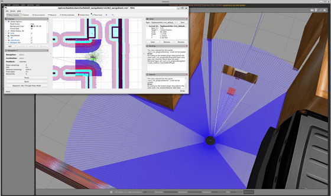
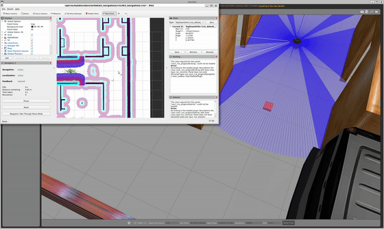
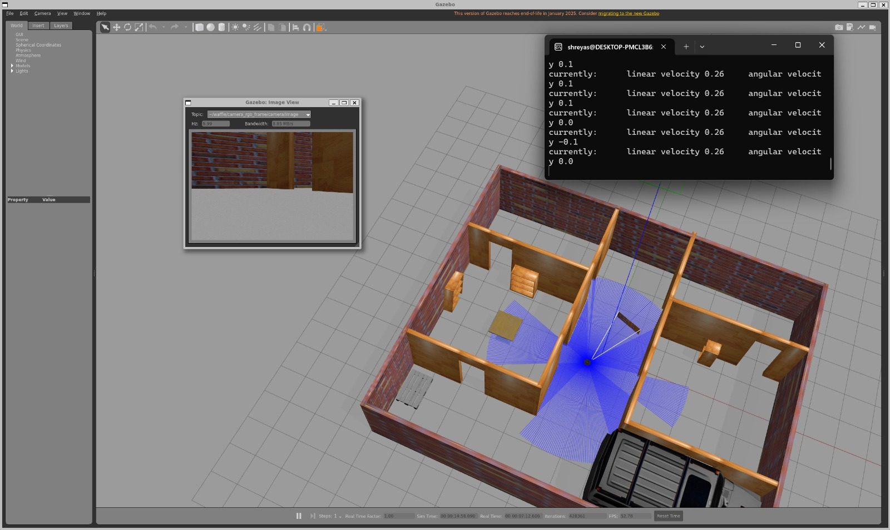
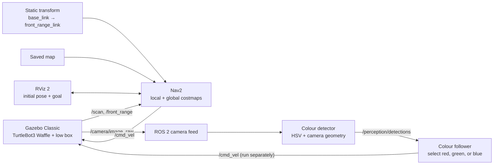
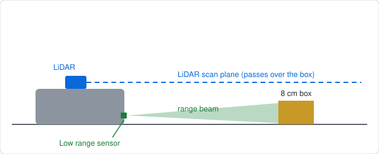
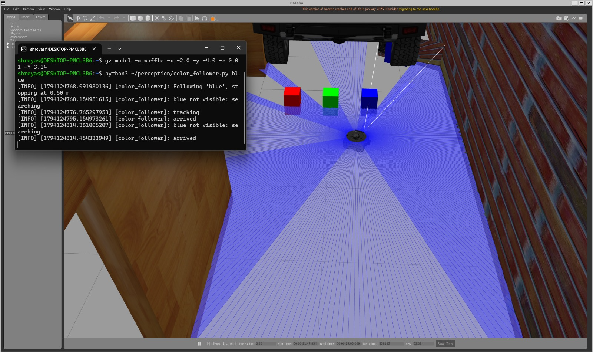

# TurtleBot3 Nav2 Camera and Range Sensor Integration


[](https://github.com/shreyas02005-sudo/nav2-camera-range-sensor/actions/workflows/ci.yml)


I added a camera and a low mounted range sensor to a TurtleBot3 Waffle in Gazebo Classic, connected the range sensor to Nav2's costmaps, and built a colour based perception demo that detects and follows simulated boxes.

**[Open the demo videos on Google Drive](https://drive.google.com/drive/folders/1_qsFUcDb3oPudGYDkgD9RKODOBYeF5Z4?usp=sharing):** range sensor navigation, box detection, and colour box following.

| LiDAR only (stock Nav2) | With the range sensor layer |
|:--:|:--:|
|  |  |

The camera feed below was received over ROS 2 at 640x480.



---

## Contents

- [What it does](#what-it-does)
- [How it fits together](#how-it-fits-together)
- [Tested environment](#tested-environment)
- [Setup and run](#setup-and-run)
- [The obstacle demonstration](#the-obstacle-demonstration)
- [Colour box perception and following](#colour-box-perception-and-following)
- [Repository layout](#repository-layout)
- [Troubleshooting](#troubleshooting)
- [What this project shows](#what-this-project-shows)
- [Limitations and next steps](#limitations-and-next-steps)
- [Related project](#related-project)
- [Acknowledgements](#acknowledgements)
- [License](#license)

---

## What it does

- Adds a **front mounted, low range sensor** to a TurtleBot3 Waffle in Gazebo Classic.
- Feeds the range data into **both Nav2 costmaps**, so the local controller and global planner can account for low obstacles.
- Resizes the robot camera and publishes images on `/camera/image_raw` and camera calibration data on `/camera/camera_info`.
- Detects red, green, and blue boxes from the camera feed and publishes their estimated bearing and distance.
- Follows a selected colour with a simple velocity controller in the simulation.
- Demonstrates the difference between stock LiDAR only parameters and Nav2 configured with the range sensor layer.

| Configuration | Obstacle in costmap | Recorded outcome |
|---|---|---|
| Stock Nav2 parameters (LiDAR only) | No | The robot did not detect the box and collided with it. |
| Nav2 with the range sensor layer | Yes (local and global costmaps) | The planner routed around the box. |

This is a qualitative demonstration from one obstacle layout, not a controlled benchmark. The available results do not establish that the start pose, goal, and box position were identical between runs.

## How it fits together



The range sensor is mounted 4 cm above the base link origin. Its five ray scan has a 0.4 rad field of view and 1.5 m maximum range. The static transform is launched separately because the range link is present in the Gazebo model but not the URDF used by `robot_state_publisher`.



*Side view, not to scale. The LiDAR plane passes over the box, but the low range sensor does not.*

The design notes in [`docs/how-it-works.md`](docs/how-it-works.md) go through the data path, the frames and the trade offs.

## Tested environment

- Ubuntu 22.04 under WSL2, ROS 2 Humble, Gazebo Classic 11 with `gazebo_ros_pkgs`
- TurtleBot3 Waffle packages built from source in `~/turtlebot3_ws` so the model can be edited
- Nav2 (`navigation2`, `nav2_bringup`) and `turtlebot3_navigation2`
- CycloneDDS (`ros-humble-rmw-cyclonedds-cpp`)
- A saved map and a Gazebo world for navigation

This project builds on a separate SLAM and navigation setup using a custom Gazebo world and a Cartographer map. You will need a working Nav2 setup of your own; see the [setup guide](docs/setup.md).

## Setup and run

You will need Ubuntu 22.04, ROS 2 Humble, Gazebo Classic 11, TurtleBot3 Waffle packages built from source in `~/turtlebot3_ws`, Nav2, a saved map, and a Gazebo world. The full [setup guide](docs/setup.md) walks through each step, including localisation, placing the test box, and running the LiDAR only comparison.

Clone this repository and run the preparation commands from its root:

```bash
REPO_DIR="$PWD"
source /opt/ros/humble/setup.bash
export RMW_IMPLEMENTATION=rmw_cyclonedds_cpp
export TURTLEBOT3_MODEL=waffle

python3 scripts/configure_camera.py
python3 scripts/add_range_sensor.py
cd ~/turtlebot3_ws
colcon build --packages-select turtlebot3_gazebo
source install/setup.bash

cd "$REPO_DIR"
mkdir -p ~/nav2_params
cp /opt/ros/humble/share/turtlebot3_navigation2/param/humble/waffle.yaml ~/nav2_params/waffle.yaml
python3 scripts/add_range_layer.py ~/nav2_params/waffle.yaml ~/nav2_params/waffle_range.yaml
```

Open separate terminals for the following launches. In each, source ROS, set `RMW_IMPLEMENTATION=rmw_cyclonedds_cpp` and `TURTLEBOT3_MODEL=waffle`, then source `~/turtlebot3_ws/install/setup.bash`:

```bash
# Terminal 1: replace with your Gazebo world launch file
ros2 launch turtlebot3_gazebo <your_world>.launch.py

# Terminal 2: from the root of this repository
ros2 launch launch/range_sensor_tf.launch.py

# Terminal 3: replace with the path to your saved map
ros2 launch turtlebot3_navigation2 navigation2.launch.py use_sim_time:=True \
  map:=<path/to/map.yaml> params_file:=$HOME/nav2_params/waffle_range.yaml
```

In RViz, set the robot's initial pose, place `models/low_box.sdf` in front of it using the coordinate conversion in the [setup guide](docs/setup.md#6-place-the-low-box), then send a goal beyond the box. For the LiDAR only baseline, follow [the comparison procedure](docs/setup.md#7-run-the-demonstration). The additional [perception guide](perception/README.md) explains how to detect and follow coloured boxes. Each new terminal needs the same ROS environment setup; see the full guide for exact commands and checks.

## The obstacle demonstration

The test obstacle is an 8 cm box (`models/low_box.sdf`), short enough that the LiDAR scan passes straight over it. I ran two trips with a goal on the far side of the box:

1. **Stock Nav2 parameters (LiDAR only).** The box never appeared in the costmap, so the planner drew a path straight through it and the robot drove into it.
2. **With the range sensor layer.** The box showed up in both costmaps and the planner routed around it.

Recordings of both runs are in the [demo folder](https://drive.google.com/drive/folders/1_qsFUcDb3oPudGYDkgD9RKODOBYeF5Z4?usp=sharing).

This is a demonstration, not a controlled experiment. I don't have a record showing that the start pose, goal and box position were identical in both runs, so I wouldn't quote it as a measured improvement. The [setup guide](docs/setup.md#7-run-the-demonstration) describes how to repeat the comparison with fixed positions.

## Colour-box perception and following

Once the camera feed worked, I used it for a small perception demo. A detector looks for red, green and blue boxes in the image, and a follower drives the robot toward whichever colour you pick.

| Piece | File | What it does |
|-------|------|--------------|
| Spawner | `perception/spawn_boxes.sh` | Spawns the coloured test boxes in Gazebo |
| Detector | `perception/color_detector.py` | Finds the boxes with HSV colour masks and estimates each one's bearing and distance, published on `/perception/detections` |
| Follower | `perception/color_follower.py` | Drives toward the selected colour with a simple velocity controller |
| Check | `perception/expected_bearing.py` | Compares the detector's bearing with Gazebo ground truth |



The follower drives straight at its target and doesn't avoid obstacles, so it doesn't use Nav2. The detector is tuned to the simulation's fixed lighting, and a similarly coloured object could be mistaken for a target. Usage and measured results are in [`perception/README.md`](perception/README.md).

## Repository layout

```text
.
├── config/
│   └── range_layer.yaml            Costmap layer settings (reference copy)
├── docs/
│   ├── setup.md                    Step-by-step reproduction guide
│   ├── troubleshooting.md          Common issues and fixes
│   └── images/                     Camera and perception screenshots
├── .github/
│   └── workflows/
│       └── ci.yml                  Python and shell syntax checks
├── perception/
│   ├── README.md                   Detection, following, and measured results
│   ├── color_detector.py           Detect coloured boxes in the camera feed
│   ├── color_follower.py           Follow a selected box colour
│   ├── expected_bearing.py         Compare detections with Gazebo ground truth
│   ├── spawn_boxes.sh              Spawn the perception test boxes
│   └── models/                     Red, green, and blue box models
├── launch/
│   └── range_sensor_tf.launch.py   Static transform for the range sensor
├── models/
│   ├── front_range_sensor.sdf.xml  Range sensor block (reference copy)
│   └── low_box.sdf                 8 cm test obstacle
└── scripts/
    ├── configure_camera.py         Reduce camera resolution and rate in model.sdf
    ├── add_range_sensor.py         Insert the range sensor into model.sdf
    ├── add_range_layer.py          Add the range layer to a Nav2 params file
    ├── check_range_layer.py        Check the range layer is in both costmaps
    ├── map_to_gazebo.py            Convert map coordinates to Gazebo coordinates
    ├── grab_frame.py               Save a camera frame and print pixel statistics
    └── clean_gz.sh                 Stop stale Gazebo/ROS processes before launching
```

The scripts patch the TurtleBot3 model and Nav2 parameters in place rather than shipping modified copies. Reference snippets are available in `models/` and `config/`.

## Troubleshooting

- **Camera topics appear but images do not arrive.** Use CycloneDDS in every terminal, including Gazebo. Details and diagnostic steps are in the [troubleshooting guide](docs/troubleshooting.md).
- **The installed robot model does not reflect your changes.** Gazebo loads the model from `install/`; check the installed copy after building.
- **The obstacle appears in the wrong place.** Convert between map and Gazebo coordinates using the measured frame offset.
- **The robot sees the obstacle locally but still collides.** Confirm that the range layer is configured in both costmaps.

See [`docs/troubleshooting.md`](docs/troubleshooting.md) for the fixes and commands.

## What this project shows

- **Nav2 integration:** connecting a new sensor to the local and global costmaps.
- **Robot model modification:** patching a TurtleBot3 Gazebo model and rebuilding its package.
- **Coordinate frames:** publishing the sensor transform and handling offsets between map and Gazebo frames.
- **Simulation debugging:** diagnosing large camera-message delivery under WSL2 and selecting CycloneDDS.
- **Classical perception:** using colour masks and camera geometry to estimate target bearing and distance.
- **Reproducible testing:** providing scripts, model snippets, and a procedure for comparing sensor configurations.

## Limitations and next steps

- Sensor readings are simulated and noise-free; a physical sensor would need threshold tuning.
- The 0.4 rad range cone is narrow, so an off axis low obstacle may not be detected until the robot turns toward it.
- The demonstration covers one world and obstacle layout and is not a statistical benchmark.
- The perception pipeline is colour based and tuned to static simulation lighting; similarly coloured objects can be mistaken for the test targets.
- The follower drives directly toward a target and does not avoid obstacles. Connecting its detections to Nav2 is a next step, along with repeating the navigation test in Isaac Sim.

## Related project

This builds on my [TurtleBot3 + Nav2 demo](https://github.com/shreyas02005-sudo/tb3_nav2_demo), which has the custom three room Gazebo world and the Cartographer map I used as the test environment.

## Acknowledgements

Built with [TurtleBot3](https://emanual.robotis.com/docs/en/platform/turtlebot3/overview/), [Nav2](https://docs.nav2.org/), [ROS 2](https://docs.ros.org/), and [Gazebo Classic](https://classic.gazebosim.org/).

## License

Released under the [MIT License](LICENSE).
