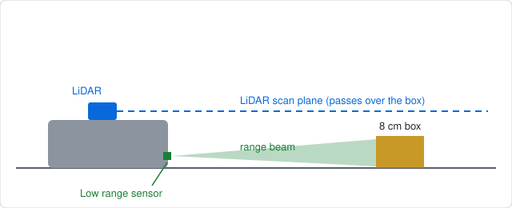
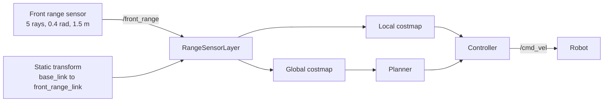

# How It Works

The ideas behind the project, and why it's built the way it is.

## The problem

A 2D LiDAR measures along one horizontal plane. Anything that sits entirely below that plane, such as a low box, is invisible to it. Nav2 builds its costmaps from sensor data, so an obstacle the LiDAR can't see never shows up in the costmap. The planner then treats the space as free and drives straight into it.

*Side view, not to scale.*

## The approach

I added a second sensor mounted low at the front of the robot and fed its readings into Nav2 through a `RangeSensorLayer`, a costmap layer that turns range readings into obstacles.

## The pieces

### The sensor

A five-ray range sensor, mounted 4 cm above the base link origin. It has a 0.4 rad field of view and a 1.5 m maximum range, and it publishes on `/front_range`. `scripts/add_range_sensor.py` adds it to the TurtleBot3 model, and `models/front_range_sensor.sdf.xml` holds a reference copy of the block.

### The transform

The range link exists in the Gazebo model, but not in the URDF that `robot_state_publisher` uses, so Nav2 has no way of knowing where the sensor is. `launch/range_sensor_tf.launch.py` publishes a static transform from `base_link` to the range link to close that gap. Without it, the readings can't be placed in the costmap.

### The costmap layer

`scripts/add_range_layer.py` takes a Nav2 params file and adds the range layer to both costmaps. Both matter:

- **Local costmap:** the controller uses it to avoid what's directly in front of the robot.
- **Global costmap:** the planner uses it to plan a route that avoids the obstacle in the first place.

With the layer in only the local costmap, the robot can notice the box at the last moment, but the global plan still goes straight through it. The settings for the layer are in `config/range_layer.yaml`.

### The camera

The camera publishes on `/camera/image_raw` and `/camera/camera_info`. `scripts/configure_camera.py` lowers its resolution and rate in the model. Full-size image messages were a problem to deliver under WSL2 with the default DDS, so the project uses CycloneDDS in every terminal, including the one running Gazebo.

### Map and Gazebo frames

The map frame and the Gazebo world frame don't share an origin. To place the box where you intend it on the map, `scripts/map_to_gazebo.py` converts map coordinates to Gazebo coordinates using the measured offset.

## Patching instead of forking

The scripts patch the TurtleBot3 model and the Nav2 params file in place, rather than shipping modified copies of them. That keeps upstream files as upstream, so you always start from the current stock version. The cost is that the scripts depend on the structure of those files, which is why CI checks the patch against the real stock Humble params.

## What the result shows

With stock parameters, the robot didn't see the box and collided with it. With the range layer, the planner routed around it. That's a qualitative result from one layout. It shows the idea works, but it doesn't measure how well.

## Trade-offs and limits

- The sensor is simulated and noise-free. A physical sensor would need threshold tuning.
- The 0.4 rad cone is narrow, so a low obstacle off to one side may go unnoticed until the robot turns towards it.
- One world and one obstacle layout were tested.

See the README for next steps.
