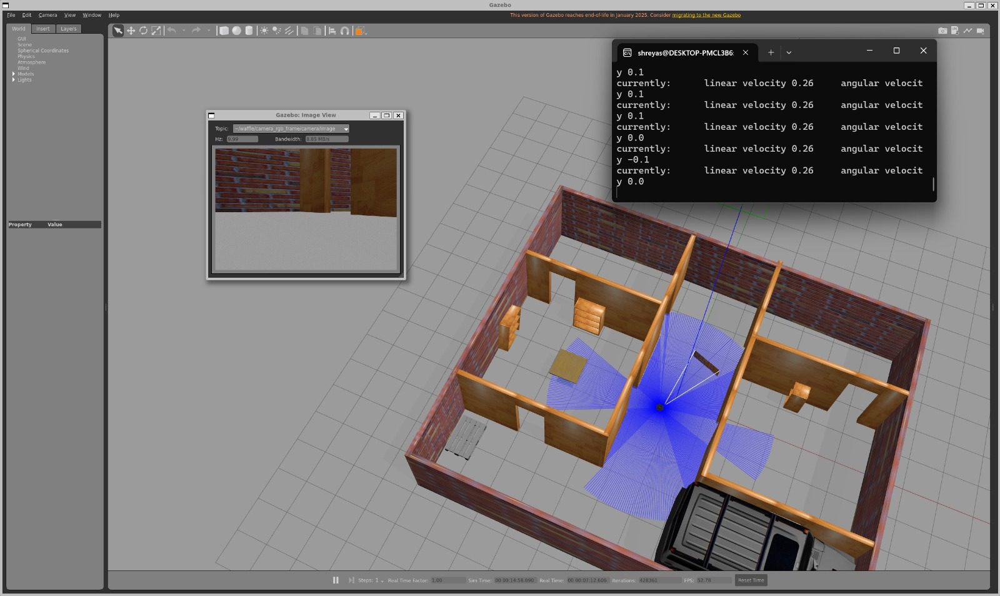

# Colour-box perception and following

This add-on uses the TurtleBot3 camera to detect red, green, and blue boxes, estimate their bearing and distance, and optionally steer the robot toward one selected colour. It is a small classical-vision pipeline: HSV thresholding, contour filtering, and pinhole-camera geometry.

The supplied test boxes are static 20 x 20 x 30 cm models. The detector assumes the 30 cm height and the resized 640 x 480 camera. It reads the camera intrinsics from `/camera/camera_info` when available.



## What is included

| File | Purpose |
|---|---|
| `color_detector.py` | Detects the largest red, green, and blue regions in `/camera/image_raw`; publishes annotated images and JSON detections. |
| `color_follower.py` | Turns toward one selected colour and drives toward it, stopping at a configurable distance. |
| `expected_bearing.py` | Estimates the expected bearing and depth from Gazebo's robot pose for comparison with the detector. |
| `spawn_boxes.sh` | Spawns the three test boxes at the original Gazebo world coordinates. |
| `models/box_*.sdf` | Static red, green, and blue 20 x 20 x 30 cm test boxes. |

## Requirements

Complete the main [setup and reproduction guide](../docs/setup.md) first so the resized camera is publishing `/camera/image_raw` and `/camera/camera_info`. Also install the Python image-processing packages if they are not already available:

```bash
sudo apt install python3-opencv python3-numpy
```

Use the system Python that can import ROS 2 Humble (`python3` after sourcing ROS). In every terminal that communicates with ROS or Gazebo, source the ROS installation and TurtleBot3 workspace and set CycloneDDS:

```bash
source /opt/ros/humble/setup.bash
source ~/turtlebot3_ws/install/setup.bash
export RMW_IMPLEMENTATION=rmw_cyclonedds_cpp
export TURTLEBOT3_MODEL=waffle
```

## Run the detector

Start the Gazebo world and robot, then spawn the test boxes once per Gazebo session:

```bash
cd <path/to/nav2-camera-range-sensor>
./perception/spawn_boxes.sh
```

The script uses fixed world coordinates: x = 0.5 m, with red at y = -3.5 m, green at y = -4.0 m, and blue at y = -4.5 m. These are the positions used in the supplied test setup. Check that they appear in the camera view before proceeding; if your world or robot start pose differs, adjust the coordinates in the spawn script.

In another sourced terminal, start the detector from the repository root:

```bash
cd <path/to/nav2-camera-range-sensor>
python3 perception/color_detector.py
```

It reports detections in the terminal and publishes:

- `/perception/annotated`: image with boxes, colour labels, bearing, and distance. In RViz, use an Image display with Reliable reliability.
- `/perception/detections`: a `std_msgs/msg/String` containing JSON with `bearing_deg`, `dist_m`, and pixel `area` for each detected colour.

To inspect the JSON in another sourced terminal:

```bash
ros2 topic echo /perception/detections std_msgs/msg/String
```

The detector keeps the largest contour per colour when its area is at least 800 pixels. Bearing comes from the horizontal pixel centroid and camera focal length. Distance uses `distance = fx * 0.3 m / pixel_height`; it is reported as `null` when the box touches the top or bottom image edge.

## Follow a selected box

**Stop Nav2 and teleoperation before starting the follower.** The follower publishes velocity commands directly to `/cmd_vel`; another controller publishing there at the same time will conflict with it. Leave Gazebo and the detector running, then start the follower in a separate sourced terminal:

```bash
cd <path/to/nav2-camera-range-sensor>
python3 perception/color_follower.py green
```

Replace `green` with `red` or `blue` to select another target. The default stopping distance is 0.5 m. To choose another stopping distance in metres, pass it as the second argument:

```bash
python3 perception/color_follower.py red 0.6
```

The controller turns in place when the target is more than 15 degrees off-axis, drives at up to 0.15 m/s when aligned, and searches in the last-seen direction if the target is lost. Press Ctrl+C to stop; on shutdown it publishes zero-velocity commands. This follower does not avoid obstacles and should only be used in the clear simulation test area.

## Compare the detector with Gazebo ground truth

The helper assumes the test-box positions above and a Waffle camera offset 6.4 cm forward and 6.5 cm to the right of the robot centre. Read the robot x, y, and yaw from Gazebo and pass them to the helper:

```bash
cd <path/to/nav2-camera-range-sensor>
python3 perception/expected_bearing.py $(gz model -m waffle -p | awk '{print $1, $2, $6}')
```

The helper prints the expected bearing and depth to each box and whether it is within the camera's approximate field of view. Its output is a simulation-ground-truth comparison, not a sensor measurement.

## Results from the supplied simulation runs

### Bearing

For fully visible boxes, bearing error was under 1 degree from 1.5 to 4 m (most comparisons were within 0.5 degrees). At 0.5 to 1 m, error reached 1.6 degrees, largest for boxes near the image edge. A partly cropped box reads biased toward the image centre. The blue box showed an approximately 1 degree right-side offset in every comparison; its cause was not investigated.

### Distance

The first distance estimate used apparent box width. It was within 1% up to 3 m and 2.5% at 4 m when viewed face-on, but read 10 to 24% too short at 15 to 25 degrees off-axis. The detector now uses box height, which does not grow when the visible side face makes the box appear wider:

| True depth | Red estimate | Green estimate | Blue estimate |
|---|---:|---:|---:|
| 1.0 m | 0.99 m | 0.99 m | 1.00 m |
| 2.0 m | 2.02 m | 2.02 m | 2.00 m |
| 4.0 m | 4.04 m | 4.04 m | 4.04 m |

Boxes were detected from about 0.5 m to 4 m. At 5 m, their image area fell below the 800-pixel threshold, so the detector did not report them.

### Following

| Test | Result |
|---|---|
| Green box, straight ahead | Stopped at 0.475 m (detector reading). |
| Red box, starting 2.3 m away and off to the side | Turned, approached, and stopped at 0.474 m. |
| Blue box, starting 2.3 m away | Stopped at 0.479 m. |
| Blue box, starting while the robot faced away | Searched for about 6.6 s, found the box, approached, and stopped. |

For the blue run, the recorded ground-truth camera-to-face depth was 0.50 m while the detector read 0.48 m. The robot stopped on target; a roughly 2 cm under-read at this distance (4%) was offset by a couple of centimetres of coasting after the stop command. The source of the under-read was not isolated; the assumed camera position in the helper is one possible contributor.

## Limitations

- The results are from Gazebo Classic. The simulated camera has no noise, distortion, or motion blur, and the lighting is constant.
- Distance estimation assumes an upright object with a known 0.3 m height; it becomes less precise at longer range as the object occupies fewer pixels.
- Bearing is less reliable when a box is partly outside the image.
- Detection is based on colour, not object identity. Other similarly coloured objects can also be detected.
- The follower drives directly toward the target and does not avoid obstacles. Combining perception with Nav2 is future work.
- Losing the target during an approach, for example if a box is removed, was not tested.
